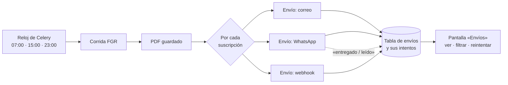

# Plan de automatización: envíos auditables del monitor y camino para renovar Oráculo

- **Fecha:** 3 de noviembre de 2026
- **Estado:** Hay un prototipo funcional de E1 y E2 (correo vía Composio) desde el 07/11/2026; ver ADR-0039. WhatsApp sigue pendiente.
- **Fase:** F12.11 (envío automático del reporte), y el modelo a seguir para Oráculo.
- **Lo que pidió Benji:**
  - que los reportes automáticos lleguen a un teléfono, a correos o a cualquier webhook;
  - renovar la automatización de Oráculo, que hoy vive en n8n, empezando por este monitor;
  - que el plan sea escalable y fácil de explicar al equipo;
  - que cada proceso sea **auditable y rastreable**, como en n8n, para saber qué corregir cuando algo falla.

---

## 1. La idea en 30 segundos

Cada vez que termina una corrida (07:00, 15:00 y 23:00), el monitor crea un **envío** por cada destinatario: un correo, un WhatsApp o un webhook. Cada envío queda registrado en la base de datos con su historia completa:

- cuándo se intentó, cuántas veces y qué respondió el proveedor;
- si llegó o si falló, y por qué.

Una pantalla **Envíos** muestra esa historia y tiene un botón **Reintentar**.

**Analogía:** una oficina de paquetería. La corrida deja el paquete (el PDF). Por cada destinatario se llena una **guía de envío** con número de rastreo, y cada intento de entrega queda anotado en la guía. Si el repartidor no encuentra a nadie, lo vuelve a intentar más tarde. Si después de varios intentos no se pudo, la guía queda en rojo para que alguien la revise. Nunca se pierde un paquete sin que se sepa en qué paso falló.

---

## 2. La regla que ordena todo

Hay dos tipos de trabajo, y cada uno lleva una herramienta distinta:

| Tipo de trabajo | Ejemplos | Herramienta correcta |
|---|---|---|
| **Fontanería fija**: siempre igual, sin decisiones | mandar el PDF a las 07:05, reintentar si falla, avisar al webhook | **Código propio**, probado y versionado. Es barato, exacto y auditable. |
| **Criterio**: leer, resumir o decidir | resumir notas, clasificar quién actúa, escribir «qué cambió esta semana» | **IA** (ya la usamos en el pipeline), y más adelante **agentes de Claude**. |

El error más común de hoy es poner una IA a hacer fontanería. Por ejemplo, un agente que «decide» mandar el correo cada mañana. Cuesta más, a veces se equivoca y es difícil de auditar. La IA va donde hace falta criterio; el envío es código.

---

## 3. El panorama de herramientas (noviembre de 2026)

| Herramienta | Qué es | Para qué **sí** | Para qué **no** | ¿Auditable? |
|---|---|---|---|---|
| **n8n** (lo que usa Oráculo) | Flujos visuales de cajitas conectadas | Prototipos rápidos y unir apps sin programar | Lógica que crece. Los flujos son difíciles de versionar, probar y revisar entre varios, y para depurar hay que abrir nodo por nodo | Sí, ve cada ejecución. La auditoría avanzada y el envío de logs son de pago (VERIFICAR qué incluye la edición gratuita) |
| **Código propio + cola de tareas** (lo que ya tiene el monitor: Celery + PostgreSQL) | Tareas en Python con reintentos; el registro lo guardamos nosotros | **Envíos fijos**: es lo que propone este plan | Flujos muy largos con esperas de días o aprobaciones humanas (ahí conviene un motor durable) | **Sí, y a nuestra medida**: tablas propias, pantalla propia y pruebas automáticas |
| **Motores durables** (Temporal, Hatchet, Inngest, Trigger.dev, Windmill) | Flujos escritos en código; el motor recuerda en qué paso iba cada uno aunque se caiga el servidor | Cuando Oráculo tenga muchos flujos de varios pasos. Hatchet usa PostgreSQL y tiene Python; Windmill combina pantalla visual y código; Temporal es el más robusto pero el más pesado | Hoy, para el monitor: sería otra pieza que operar sin necesitarla | Sí: cada ejecución se ve paso a paso |
| **Agentes de Claude** (Managed Agents, con corridas programadas por cron) | Un agente en la nube de Anthropic que corre a una hora fija y usa herramientas | Tareas con **criterio** y horario. Por ejemplo, «cada lunes revisa las corridas de la semana y escribe qué cambió», con una rúbrica que el resultado debe cumplir | Fontanería: costaría tokens en cada envío y no siempre haría lo mismo | Sí: cada sesión guarda sus eventos y avisa por webhooks firmados. Está en beta (`managed-agents-2026-04-01`) |
| **Composio** | Capa para que un **agente** use cientos de apps (Gmail, Slack, Drive…), con el inicio de sesión de cada usuario resuelto | Agentes que actúan en las cuentas de las personas | Mandar un reporte fijo: sería un intermediario más que guarda credenciales | Depende de lo que registremos nosotros |
| **Claude Code** (con lo que trabajamos) | Claude escribe, prueba y documenta el código | **Construir** las automatizaciones mucho más rápido | Correr en producción: no es el que ejecuta, es el que construye | El código y sus commits quedan en git |

**En corto:** «automatizar con Claude» hoy significa dos cosas.
1. **Construir más rápido:** Claude Code escribe el código con pruebas, como en este proyecto.
2. **Agentes con criterio que corren solos:** Managed Agents. Esta parte va después de tener los envíos.

---

## 4. Cómo funcionaría en el monitor

### 4.1 Las piezas

1. **Suscripciones** (`delivery_subscriptions`): quién recibe qué. Cada una guarda:
   - el canal (correo, WhatsApp o webhook) y el destino (una dirección, un número o una URL);
   - qué evento la dispara: por ahora, «terminó una corrida automática»;
   - el formato (PDF adjunto o link seguro) y si está prendida.

   Se editan en pantalla y cada cambio queda en la bitácora.
2. **Envíos** (`deliveries`): **una guía por suscripción y por corrida**, con su número de rastreo. Estados:

   `pendiente → enviando → enviado → entregado` (o `leído` en WhatsApp)

   y, si algo sale mal, `reintentando → fallido`.

   No puede haber dos guías para la misma corrida y el mismo destinatario (es una regla de la base). Por eso, aunque la tarea se repita, nadie recibe el reporte dos veces. A esto se le llama **idempotencia**.
3. **Intentos** (`delivery_attempts`): cada intento de cada envío, con:
   - hora y duración;
   - el código que respondió el proveedor;
   - su número de mensaje (el `id` de WhatsApp o el `Message-ID` del correo);
   - el error en español, si hubo.

   Es el equivalente a abrir una ejecución en n8n.
4. **La tarea que envía** (Celery). Toma los envíos pendientes y reintenta con espera creciente: 1 minuto, luego 5, luego 30. Al cuarto intento lo marca **fallido** y avisa a un correo de administración.
5. **Un adaptador por canal**, detrás de una misma interfaz (arquitectura hexagonal, como el resto del proyecto):
   - **Webhook:** un `POST` con el resumen de la corrida en JSON y el link al PDF. Va **firmado** con HMAC-SHA256 siguiendo el estándar *Standard Webhooks* (cabeceras `webhook-id`, `webhook-timestamp` y `webhook-signature`), el mismo que usa Anthropic. Con la firma, quien lo recibe sabe que viene de nosotros y que nadie lo cambió en el camino. **Sirve para cualquier sistema, incluido n8n.**
   - **Correo:** SMTP, que funciona con cualquier proveedor (Amazon SES, Resend, Postmark o el correo de la empresa). Lleva el resumen en el cuerpo y el PDF adjunto o un link.
   - **WhatsApp:** la API oficial de Meta (Cloud API), con una **plantilla aprobada** de tipo «utilidad» que lleva el PDF como documento. Meta avisa por webhook cuando el mensaje se entrega y cuando se lee, y eso queda en la guía.
6. **Pantalla «Envíos»**:
   - la lista, con filtros por estado, canal, fecha y corrida;
   - el detalle de cada intento;
   - **Reintentar** y la edición de suscripciones.
7. **Rastreo de punta a punta:** el número de la corrida (`search_id`) va en cada envío y en cada línea del log (JSON). Desde la corrida se ven sus envíos, y desde un envío se llega a su corrida y a su PDF.

### 4.2 Dónde se conecta

En `run_automatic_job` ([backend/app/worker/automatic_jobs.py](../backend/app/worker/automatic_jobs.py)), justo después de guardar el PDF, se crean las guías y se encola la tarea que envía. Si el PDF falló, se envía igual el aviso con el resumen y la falla registrada; nunca hay silencio.

### 4.3 PDF adjunto o link seguro

El reporte habla de la FGR y puede ser sensible. Hay dos formas de mandarlo:

- **Adjunto:** lo más simple. El archivo vive en el correo o en el WhatsApp de cada persona.
- **Link seguro que caduca** (por ejemplo, en 72 horas): el PDF no sale del servidor y se puede revocar. A cambio, hay que publicar el servidor (lo resuelve la mudanza a Proxmox, F12.9).

**Recomiendo:** adjunto para empezar (correo y WhatsApp) y link seguro cuando el servidor esté publicado.

### 4.4 ¿Y los WhatsApp «baratos»? (investigado el 4/11/2026)

Cuando se habla de mandar WhatsApp «más barato y sin pasar por WhatsApp», casi siempre es una de dos cosas:

1. **APIs no oficiales:** Evolution API, WAHA, WasenderAPI, Whapi.Cloud y otras.
   - **Cómo funcionan:** conectan un número normal escaneando un código QR, como WhatsApp Web, y mandan mensajes desde ahí.
   - **Costo:** algunas son gratis si se instalan en un servidor propio (Evolution API y WAHA); otras cobran una cuota fija, de unos 6 USD al mes por número en WasenderAPI y unos 29 USD en Whapi. Sin plantillas ni aprobaciones de Meta. Evolution API es muy común en comunidades de n8n.
   - **El riesgo:** WhatsApp no las autoriza y va contra sus condiciones de uso. Meta detecta estas conexiones y **bloquea el número**, muchas veces para siempre. Las fuentes de 2026 dicen que lo está haciendo más seguido.
   - **Otros problemas:** no hay a quién reclamar si se cae, dejan de funcionar cuando WhatsApp cambia su app, y los mensajes pasan por un tercero.
2. **Intermediarios oficiales** (360dialog, Twilio, Gupshup, WATI).
   - Usan la misma API oficial de Meta. **No bajan el precio de Meta**: le suman su comisión o una cuota mensual.
   - 360dialog cobra una cuota fija, de unos 49–50 USD al mes, sin comisión por mensaje.
   - Twilio suma unos 0.005 USD por mensaje.
   - Lo que ganas es un alta más fácil y soporte, no un precio menor.

**Nuestra cuenta** con la API oficial: 3 corridas al día son unos 90 mensajes al mes por persona. A 0.0085 USD cada uno, salen unos **0.77 USD al mes por persona** (unos 14 pesos). Con 10 destinatarios, unos 7.7 USD al mes. A este volumen, lo no oficial ahorra muy poco y arriesga perder el número.

**Recomendación:**
- **Producción:** la API oficial, directo con Meta, o con 360dialog si el alta se complica.
- **Nunca un canal no oficial para el reporte de la FGR**, por el riesgo de bloqueo y porque la información pasaría por un tercero sin contrato.
- **Si se quiere un canal gratis:** un **bot de Telegram** es gratuito y oficial (VERIFICAR).

---

## 5. Por qué así y no todo en n8n

- **Se versiona y se revisa.** Cada cambio es un commit con su prueba; en n8n, un cambio en un nodo no deja rastro claro de qué cambió ni por qué.
- **Se prueba sin mandar nada.** Las pruebas usan respuestas grabadas (como hoy con SearchApi), así que nunca llega un WhatsApp de prueba a nadie por accidente.
- **La auditoría es nuestra.** La guía y sus intentos viven en nuestra PostgreSQL, con el mismo respaldo que todo lo demás, y no dependen de la licencia de otra herramienta.
- **n8n no se tira de golpe.** El webhook firmado permite que los flujos actuales de Oráculo en n8n sigan recibiendo los reportes mientras se migran. Se le llama **migración por estrangulamiento**: lo nuevo crece alrededor de lo viejo y lo va reemplazando flujo por flujo, sin un día de «apagar todo».

---

## 6. Etapas

Cada etapa termina con código, pruebas, documentación, verificación con salida real y commit (CLAUDE.md §2).

| Etapa | Qué se entrega | Cómo se verifica | Costo |
|---|---|---|---|
| **E0 · Cuentas y decisiones** (Benji y el equipo) | La lista de destinatarios. Para WhatsApp: verificar la empresa en Meta Business, dar de alta un número y aprobar la plantilla. Para correo: el dominio y su DNS (SPF, DKIM y DMARC, para que no caiga en spam) | Meta aprueba la plantilla y el dominio pasa la revisión del proveedor | Tiempo: Meta suele tardar de días a semanas |
| **E1 · Base auditable y webhook** | Migración con las 3 tablas e índices, el dominio (estados, reintentos, firma), el puerto, la tarea de Celery, el canal webhook y `make probar-envio`. Pantalla «Envíos» de solo lectura | Una corrida real manda su webhook a un receptor local (`make recibir-webhooks`), que muestra 5 envíos con su firma válida. Pruebas de reintento, de idempotencia y de una firma alterada | 0 |
| **E2 · Correo** | Adaptador SMTP, plantilla del correo (resumen y PDF) y suscripciones en pantalla | Un correo real a Benji con tu OK; se ven el `Message-ID` y el intento en «Envíos» | Centavos por miles de correos (VERIFICAR el proveedor) |
| **E3 · WhatsApp** | Adaptador de la Cloud API, plantilla `reporte_fgr` y webhook de estados (entregado y leído) | Un WhatsApp real al número de Benji con tu OK; la guía pasa a «entregado» y luego a «leído» | Unos 0.0085 USD por mensaje de utilidad en México desde el 1/10/2026 (VERIFICAR en la página de precios de Meta) |
| **E4 · Operación** | Reintentar desde pantalla, aviso de fallas al administrador, resumen diario de envíos y documentación para el equipo | Simular una caída del proveedor: los reintentos quedan registrados y llega el aviso | 0 |
| **E5 · Modelo para Oráculo** | La guía «cómo se hace una automatización auditable» con plantilla de código, el contrato del webhook y el primer flujo de n8n migrado como ejemplo | El equipo reproduce el ejemplo siguiendo la guía | 0 |
| **E6 · (Después) Agente con criterio** | Un agente de Claude programado (por ejemplo, cada lunes «qué cambió en la semana») que lee las corridas por la API y entrega su texto **por el mismo sistema de envíos** | Una corrida del agente con su rúbrica cumplida y su envío en «Envíos» | Tokens por corrida; se estima antes |

**Orden recomendado:** webhook, luego correo, luego WhatsApp. El webhook no depende de nadie y prueba toda la base. El correo es inmediato. WhatsApp depende de las aprobaciones de Meta, así que E0 conviene arrancarlo ya, en paralelo.

### 6.1 Archivos de E1 a E3 (propuesta)

- `backend/alembic/versions/…_0035_envios.py`: las 3 tablas, con sus índices en la misma migración (CLAUDE.md §6.3).
- `backend/app/domain/deliveries.py`: estados permitidos, reglas de reintento y la firma del webhook. Sin librerías externas.
- `backend/app/application/ports/deliveries.py` (`DeliveryChannelPort`, `DeliveryStorePort`) y `backend/app/application/use_cases/deliver_report.py` (crear guías, enviar y reintentar).
- `backend/app/adapters/delivery/`: `webhook.py`, `email_smtp.py`, `whatsapp_cloud.py`, cada uno probado con respuestas grabadas en `tests/fixtures/`.
- `backend/app/api/v1/deliveries.py` (lista, detalle, reintentar y suscripciones) y `backend/app/api/v1/whatsapp_webhook.py` (estados de Meta, con firma verificada).
- `backend/app/worker/`: la tarea de envío y su enganche en `automatic_jobs.py`.
- `frontend/src/components/Deliveries/`, `frontend/src/services/deliveries.ts` y `frontend/src/hooks/useDeliveries.ts`.
- `.env.example`: `SMTP_*`, `WHATSAPP_*`, `WEBHOOK_SIGNING_SECRET` y `DELIVERY_ADMIN_EMAIL`.
- Documentación: `docs/adr/0039-envios-auditables.md`, `docs/api.md` (contrato del webhook), CLAUDE.md §9 y CHANGELOG.

---

## 7. Riesgos

| Riesgo | Qué hacemos |
|---|---|
| **Meta rechaza la plantilla o tarda en verificar la empresa** | Arrancar E0 ya. Mientras tanto funcionan correo y webhook. Plan B: un intermediario (Twilio o 360dialog), más fácil de dar de alta pero con cobro extra (VERIFICAR) |
| **Meta cambia precios o reglas** (lo hizo el 1/10/2026) | El costo por mensaje queda en cada guía y la pantalla suma lo gastado al mes |
| **Los correos caen en spam** | Dominio con SPF, DKIM y DMARC antes de mandar; empezar con pocos destinatarios |
| **La PC apagada a la hora de la corrida** | No hay corrida ni envío. Se resuelve con la mudanza a Proxmox (F12.9). Mientras tanto, la pantalla deja ver qué corridas no ocurrieron |
| **Información sensible fuera del sistema** (WhatsApp y correo pasan por Meta y el proveedor) | Decidir qué contiene el mensaje: resumen corto y PDF, o solo un link seguro. Los secretos solo van en `.env` |
| **Mandar dos veces o a quien no es** | Una guía única por corrida y destinatario; suscripciones con bitácora; pruebas que nunca mandan nada real |

---

## 8. Decisiones que necesito de Benji

1. **Orden de canales:** webhook, correo y WhatsApp (recomendado), u otro.
2. **WhatsApp:** directo con Meta (más barato, sin intermediario; recomendado) o con un intermediario (más fácil de dar de alta, pero cobra extra).
3. **Correo:** ¿la empresa tiene dominio y correo propio (Google Workspace, Microsoft 365)? Si no, Amazon SES o Resend.
4. **Formato:** PDF adjunto para empezar (recomendado), o link seguro desde el principio.
5. **Destinatarios iniciales:** solo Benji para las pruebas, y después la lista.
6. **¿Qué flujo de n8n de Oráculo migramos primero como ejemplo** en E5? Conviene uno pequeño y que duela cuando falla.

---

## 9. Glosario para el equipo

- **Webhook:** un aviso automático por internet. Un sistema le hace `POST` a la URL de otro cuando pasa algo: «terminó la corrida, aquí está el resumen».
- **Firma HMAC:** un sello hecho con un secreto que solo conocen el que envía y el que recibe. Si alguien cambia el mensaje, el sello ya no coincide.
- **Idempotencia:** repetir algo no cambia el resultado. Si la tarea de envío se corre dos veces, el reporte llega una sola.
- **Reintento con espera creciente:** si falla, se vuelve a intentar al minuto, luego a los 5 y luego a los 30, para no saturar a un proveedor caído.
- **Plantilla de WhatsApp:** un mensaje con huecos («Reporte FGR de las {{1}}») que Meta aprueba antes. Es la única forma de escribirle primero a alguien por la API oficial.
- **Motor durable:** un programa que recuerda en qué paso va cada flujo aunque se apague el servidor, y lo retoma donde se quedó.
- **Agente:** una IA que decide qué herramientas usar para cumplir una tarea. Sirve para el criterio, no para la fontanería.

---

## 10. Fuentes consultadas (3/11/2026)

- Composio, documentación oficial: <https://docs.composio.dev/>
- Precios de la plataforma de WhatsApp Business (Meta): <https://developers.facebook.com/documentation/business-messaging/whatsapp/pricing>
- Envío de mensajes y documentos en la Cloud API (Meta): <https://developers.facebook.com/docs/whatsapp/cloud-api/reference/messages/>
- Tarifas de WhatsApp en México 2026 (fuente secundaria; confirmar con Meta): <https://itechdev.com.mx/en/blog/precio-whatsapp-business-api-mexico-2026>
- Riesgos de las APIs no oficiales de WhatsApp (fuentes secundarias): <https://wapilot.io/cheap-whatsapp-api-providers-ban-risk>, <https://wasphere.com/blog/open-source-whatsapp-api-landscape-2026/>
- Cambio de precios del 1/10/2026 (fuente secundaria): <https://respond.io/blog/whatsapp-pricing-change-2026>
- Intermediarios oficiales y sus comisiones (fuente secundaria): <https://ezcontact.ai/en/blog/whatsapp-api-pricing-comparison-meta-twilio-360dialog-ezcontact/>
- Licencia de n8n (Sustainable Use License): <https://docs.n8n.io/n8n-community-license/sustainable-use-license>
- Comparativa de motores durables (fuente secundaria): <https://www.pkgpulse.com/guides/hatchet-vs-trigger-dev-v3-vs-inngest-durable-workflows-2026>
- Managed Agents de Claude: corridas programadas, eventos y webhooks firmados. Lo tomé de la documentación oficial que trae Claude Code (`managed-agents-scheduled-deployments`, `managed-agents-webhooks`); antes de usarlo se confirma en <https://docs.claude.com>.

Lo marcado **VERIFICAR** se confirma en la documentación vigente antes de escribir código (CLAUDE.md §2.7).
