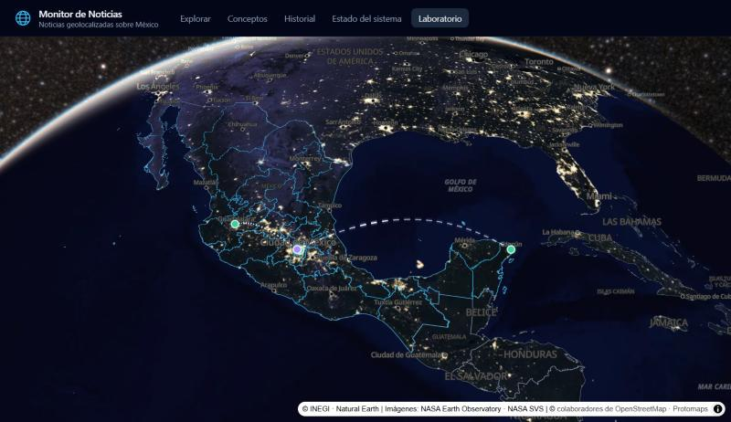
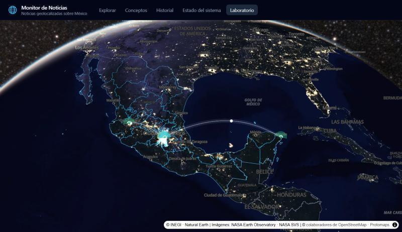
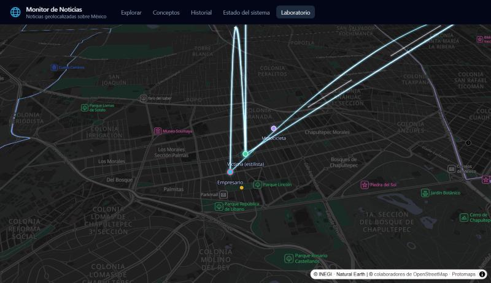
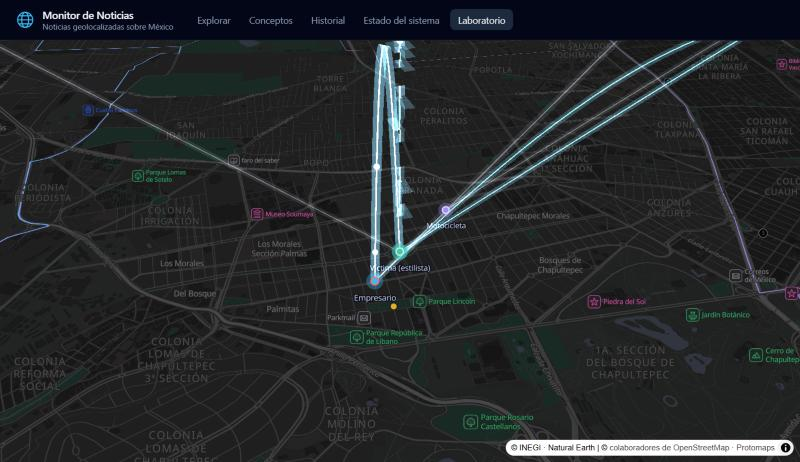

# ADR-0102 — Motor visual del muro: capa propia de MapLibre sobre el mismo globo

- **Estado:** aceptado (recomendación medida; Benji puede revertirla en la revisión de la 9.1)
- **Fecha:** 2026-10-20
- **Fase:** F9 (sub-fase 9.1)
- **Decide:** Benji
- **Complementa:** ADR-0004 (MapLibre, globo y PMTiles), ADR-0007 (MapLibre v6) y ADR-0017 (Tierra realista y movimiento)
- **Bloque:** ADR-0101 a 0105 de las fases 9–11 (`docs/PLAN_FASES_9-10-11.md`)

## Contexto

La Fase 9 convierte el monitor en un tablero de investigación: las entidades de un caso (personas, lugares, organizaciones, vehículos) y sus vínculos se dibujan **sobre el globo 3D** como nodos que brillan y arcos de luz, con cámara de cine. El plan pide decidir con evidencia, antes de construir el muro (9.6), si basta con potenciar el globo actual de MapLibre o si conviene otro motor, con el criterio de **mantener 60 fps en un equipo de oficina**.

### Cómo se midió

Se hizo un **laboratorio** solo para desarrollo (`?laboratorio`, pestaña "Laboratorio", código en `frontend/src/lab/`):

- usa el **mismo** globo de Explorar (`buildMapStyle`, Tierra de noche, fondo espacial, `smoothFlights`, `globeCamera`);
- dibuja un caso de prueba anónimo de Polanco (9 nodos y 9 vínculos, de CDMX a Zapopan, Neza y Cancún) y casos sintéticos de 25, 150 y 500 nodos con 1.5 vínculos por nodo (una cuarta parte entre ciudades);
- corre siempre el mismo guion de cámara:
  - **giro** del globo (5 s);
  - **vuelo** para encuadrar el caso (3 s);
  - **órbita** de 360° a un nodo, a zoom 11.5 con inclinación de 55° (6 s);
  - **cerca**: zoom 14 en Polanco, girando 40° (4 s).
- en cada paso hace 1 vuelta de calentamiento (carga teselas) y 3 medidas;
- de cada medida saca fps promedio, p95 del tiempo de cuadro y la parte de cuadros lentos (más de 16.7 ms + 0.5 ms de tolerancia). El resumen promedia fps y lentos y se queda con el peor p95 (`fpsMeter.ts`, con pruebas);
- el **control** es el mismo guion sin muro;
- además se midió el **tiempo de GPU y CPU de cada cuadro** del mapa, con la cámara quieta y el mapa redibujándose 3 s. La GPU se midió con `EXT_disjoint_timer_query_webgl2` y la CPU con el reloj alrededor del dibujo de MapLibre. Es la medida más limpia del costo del muro: no depende del monitor.

**Equipo:**
- esta PC: Windows 11 y el navegador integrado de la app;
- GPU Intel UHD integrada (ANGLE, Direct3D 11);
- monitor de 144 Hz y escala de Windows 125 %.

No hay otro "equipo de oficina" para comparar.

**Resolución:** las pasadas que cuentan se hicieron con la ventana del panel: 1207×698 px CSS, lienzo de 1509×798. Una primera pasada a 1920×1080 emulado (lienzo de 2400×1274) quedó incompleta porque el panel se ocultó a media medida; lo que sí se midió está al final como referencia.

### Hallazgos previos

1. **El globo solo no llega a 60 fps en este equipo.**
   - Sin muro hace de 46 a 84 fps según el paso y la hora; a 1920×1080, solo de 35 a 40.
   - El globo completo usa 14.3 ms de GPU por cuadro, casi todo el presupuesto de 16.7 ms.
   - De cerca (zoom 11.5 a 14), MapLibre usa 11–12 ms de CPU por cuadro.

   Por eso el criterio de la 9.1 se evalúa **contra el control**, como se propuso en el plan.
2. **El control varía durante la sesión.** En una pasada bajó 15 % entre el inicio y el final (calor del equipo o caché de teselas). Por eso las comparaciones que deciden son **intercaladas** (control, A, B, A, control) y con la página recién cargada.
3. **Los cuadros se redondean al monitor.** En uno de 144 Hz cada cuadro dura un múltiplo de 6.9 ms (13.9, 20.8, 27.8…), y por eso los p95 salen en esos valores.
   - Un costo pequeño se ve como una caída grande de fps cuando empuja el cuadro al siguiente escalón.
   - En un monitor de 60 Hz los escalones son de 16.7 ms y el efecto cambia. No se pudo medir aquí.

## Opciones probadas

| | A. MapLibre propio | B. deck.gl 9.4 sobre MapLibre | C. CesiumJS |
|---|---|---|---|
| Cómo | Capa propia de MapLibre (`CustomLayerInterface`, modo 3D). Cada arco es una cinta en pantalla levantada sobre el globo con las piezas del preludio de MapLibre (`projectToSphere` y `globeComputeClippingZ`, que recorta lo que queda detrás del horizonte). Brillo aditivo y pulso de luz en el shader; sugeridos punteados. Nodos: capas de círculo de MapLibre (halo difuso que late y núcleo con el color del estatus legal) | `MapLibreOverlay` entrelazado (mismo contexto WebGL). `PathLayer` de halo y núcleo con la misma geometría de A; `ScatterplotLayer` para los nodos y para la luz que recorre el arco (sin `TripsLayer`, que está en `geo-layers`) | No se prototipó: solo se prueba si A y B fallan |
| Código | `frontend/src/lab/muroMapLibre.ts` | `frontend/src/lab/muroDeck.ts` (quitado; está en `1998e2b`) | — |
| Dependencias nuevas | Ninguna | `@deck.gl/core`, `layers` y `maplibre` 9.4.0, `@luma.gl/*` 9.4.2 y `@loaders.gl/core` 4.5.2 | `cesium` |
| Peso | 0 | El pedazo del laboratorio pasa a 669 KB (189 KB comprimido) | — |

Las etiquetas de los nodos son de MapLibre en las dos opciones (texto nítido con las fuentes del mapa, que traen la Ñ). Así la diferencia es solo el dibujo de nodos y arcos.

**Documentación consultada el 20/10/2026:**

- **deck.gl:**
  - [usar con MapLibre](https://deck.gl/docs/developer-guide/base-maps/using-with-maplibre) y [`@deck.gl/maplibre`](https://deck.gl/docs/api-reference/maplibre/overview);
  - [`ArcLayer`](https://deck.gl/docs/api-reference/layers/arc-layer): advierte que en el globo los arcos pueden no verse desde ciertos ángulos;
  - [`GlobeView`](https://deck.gl/docs/api-reference/core/globe-view): marcada como experimental y sin alta precisión arriba de zoom 12;
  - [`TripsLayer`](https://deck.gl/docs/api-reference/geo-layers/trips-layer) y [novedades de la v9.4](https://deck.gl/docs/whats-new).
- **MapLibre:** [`CustomLayerInterface`](https://maplibre.org/maplibre-gl-js/docs/API/interfaces/CustomLayerInterface/) y [`CustomRenderMethodInput`](https://maplibre.org/maplibre-gl-js/docs/API/type-aliases/CustomRenderMethodInput/). Los tipos de `maplibre-gl@6.14.0` instalado dicen que:
  - `defaultProjectionData` hace que la proyección acepte coordenadas Mercator de 0 a 1;
  - en el globo la altura va en metros sobre la esfera;
  - en Mercator, la altura va en unidades Mercator.
- **CesiumJS:** [referencia 1.146](https://cesium.com/learn/cesiumjs/ref-doc/).

## Resultados

### Lo que decide: 150 nodos, intercalado y con A corregido

Promedio de las dos corridas de cada opción y de los dos controles (pasada 4). Entre paréntesis, la diferencia contra el control.

| Paso | Control | A. MapLibre propio | B. deck.gl |
|---|---|---|---|
| Giro | 47.9 fps | 44.6 fps (−7 %) | 39.6 fps (−17 %) |
| Vuelo | 65.0 fps | 51.8 fps (−20 %) | 44.6 fps (−31 %) |
| Órbita (zoom 11.5) | 76.1 fps | 65.7 fps (−14 %) | 55.0 fps (−28 %) |
| Cerca (zoom 14) | 66.3 fps | 65.9 fps (−1 %) | 53.4 fps (−19 %) |

A da entre 13 y 23 % más fps que B en todos los pasos.

Las cinco corridas una por una (fps · p95 · cuadros lentos)

| Orden | Opción | Giro | Vuelo | Órbita | Cerca |
|---|---|---|---|---|---|
| 1 | Control | 49.3 · 27.8 ms · 81 % | 67.1 · 21.0 · 34 % | 79.7 · 20.8 · 6 % | 67.8 · 20.9 · 17 % |
| 2 | A | 45.2 · 27.9 · 92 % | 52.6 · 27.8 · 66 % | 67.3 · 20.9 · 20 % | 67.1 · 20.9 · 19 % |
| 3 | B | 39.6 · 34.7 · 98 % | 44.6 · 27.9 · 88 % | 55.0 · 21.0 · 59 % | 53.4 · 27.8 · 62 % |
| 4 | A | 44.0 · 27.9 · 96 % | 51.0 · 27.8 · 72 % | 64.0 · 21.0 · 25 % | 64.6 · 21.0 · 24 % |
| 5 | Control | 46.5 · 27.9 · 90 % | 62.9 · 21.2 · 45 % | 72.5 · 20.9 · 12 % | 64.7 · 21.0 · 23 % |

La pasada 3, también intercalada y antes de corregir A, dio lo mismo: B 38–39 / 44 / 54 / 52–53 y A 43–45 / 51–53 / 63–67 / 60–67.

### Costo por cuadro: milisegundos que suma el muro

Mediana de 3 s con la cámara quieta. Control en ms; las opciones, en ms **que agregan** al control (GPU / CPU).

| Vista | Control (GPU / CPU) | A · 150 | B · 150 | A · 500 | B · 500 |
|---|---|---|---|---|---|
| Globo completo sobre México (zoom 4.4) | 14.3 / 4.3 | +1.2 / +1.4 | +1.5 / +2.0 | +3.6 / +1.8 | +4.9 / +2.0 |
| Órbita (zoom 11.5) | 9.4 / 10.9 | +1.8 / +1.6 | +3.0 / +1.7 | +4.0 / +2.3 | +6.5 / +1.3 |
| Polanco (zoom 14) | 7.1 / 11.7 | +0.5 / +1.5 | +2.0 / +1.3 | +0.9 / +1.8 | +5.8 / +1.3 |

- A cuesta menos GPU que B en todas las vistas.
- De cerca la diferencia crece: con 500 nodos, B suma 5.8 ms y A menos de 1.
- La CPU es parecida en las dos (+1.3 a +2.3 ms).

**Qué cuesta cada pieza de A** (150 nodos, globo completo): los arcos solos suman ~0.8 ms de GPU; los nodos, halos y etiquetas sin arcos, ~0.65 ms; todo junto, 1.2 ms.
- Ninguna pieza domina. Por eso, al quitar una sola (latido, halo, etiquetas o arcos), los fps del guion no se movieron: 44–45 / 50–51 / 63–66 / 58–65.
- Con todo el muro oculto, A vuelve al nivel del control: 46.8 / 62.9 / 73.4 / 63.4.
- Los ~1.5 ms de CPU tampoco salen de una pieza: aparecen igual sin arcos o sin nodos. Se perfilan en la 9.6.

### Todos los tamaños de caso (pasada 2, en orden de tiempo)

fps promedio de 3 medidas. El control se midió al principio y al final; los de en medio cargan la deriva de la sesión. La órbita y el "cerca" de A se midieron antes de corregir la altura (ver "Lo que se vio"). En la pasada 4, la corrección no cambió los fps de A.

| Opción · caso | Giro | Vuelo | Órbita | Cerca |
|---|---|---|---|---|
| Control (inicio) | 54.9 | 69.1 | 68.2 | 73.2 |
| A · 25 nodos | 52.3 | 59.2 | 72.6 | 69.9 |
| A · 150 | 45.3 | 53.4 | 66.8 | 69.7 |
| A · 500 | 40.6 | 46.0 | 56.8 | 63.7 |
| B · caso de prueba (9) | 41.0 | 44.8 | 48.1 | 55.1 |
| B · 25 | 40.6 | 47.1 | 57.4 | 55.9 |
| B · 150 | 38.4 | 43.8 | 52.6 | 51.4 |
| B · 500 | 33.4 | 38.7 | 43.1 | 44.0 |
| Control (final) | 46.0 | 59.8 | 57.6 | 63.7 |
| A · caso de prueba (9), después del control final | 46.8 | 50.0 | 54.2 | 60.8 |

### Referencia a 1920×1080 (pasada 1, incompleta)

| Opción · caso | Giro | Vuelo | Órbita | Cerca |
|---|---|---|---|---|
| Control | 35.2 | 39.2 | 39.6 | 36.7 |
| A · caso de prueba (9) | 32.8 (−7 %) | 31.7 (−19 %) | 36.2 (−9 %) | 34.8 (−5 %) |
| A · 25 | 33.2 | 33.1 | — | — |

A esa resolución el globo solo ya va a 35–40 fps; el muro resta lo mismo en proporción.

### Lo que se vio

| | A. MapLibre propio | B. deck.gl |
|---|---|---|
| Globo completo |  |  |
| Polanco a zoom 14 |  |  |

- **A en el globo:**
  - el halo de los arcos es suave y los sugeridos se ven punteados;
  - CDMX–Cancún se curva sobre el golfo y se oculta tras el horizonte sin cortes;
  - los nodos son círculos de MapLibre: se tocan con `queryRenderedFeatures`, igual que las noticias.
- **B en el globo:**
  - los halos de los nodos se ven como manchas planas, y en CDMX se suman en blanco;
  - el punteado de los sugeridos pide `@deck.gl/extensions`, que no se instaló.
- **Zoom 14, B:** los arcos casi verticales se ven escalonados (bloques blancos a lo largo de la línea). Es lo que la documentación de `GlobeView` avisa: no hay alta precisión arriba de zoom 12.
- **Zoom 14, A:** líneas limpias y los arcos nacen justo en el nodo. Esta revisión encontró un error del prototipo A, ya corregido:
  - arriba de zoom ~12 MapLibre cambia el globo a la variante "mercator" de su preludio (`shaderData.variantName`), y entre zoom ~11 y 12 mezcla el globo con el plano;
  - en el plano, la altura va en unidades Mercator y no en metros;
  - `projectTileWithElevation` usa el mismo número para las dos, y A le mandaba metros: a zoom 14 los arcos salían disparados hacia arriba y entre 11 y 12 se veían rectos;
  - ahora A hace la mezcla él mismo (`projectArc`), con la altura en las unidades de cada proyección. Revisado a zoom 4.2, 11.95, 12.05 y 14: sin saltos.

## Decisión

1. **El muro se dibuja con la opción A: una capa propia de MapLibre sobre el mismo globo de Explorar.**
   - Es más rápida que deck.gl en todos los pasos y tamaños: de 13 a 23 % más fps con 150 nodos, y menos GPU por cuadro.
   - Se ve limpia a zoom 14.
   - No agrega dependencias.
   - Usa el recorte en el horizonte de MapLibre, y sus nodos se seleccionan igual que las noticias.
2. **No se prueba CesiumJS.** A funciona sobre el globo que ya existe. Cesium obligaría a rehacer el mapa base PMTiles, el estilo y el clic en regiones (ADR-0017 ya lo descartó para Explorar).
3. **Se quita deck.gl** del proyecto (prototipo y dependencias). Queda en el historial de Git (`1998e2b`) por si una fase futura lo necesita.
4. **El criterio de 60 fps se vuelve relativo al globo sin muro**, porque en este equipo el globo solo no llega a 60 en vuelos ni a 1920×1080:
   - con 150 nodos, el muro no debe bajar más de 10 % frente al control en ningún paso;
   - **hoy A lo cumple en el giro (−7 %) y de cerca (−1 %), pero no en la órbita (−14 %) ni en el vuelo (−20 %)**. Cerrar esa brecha es trabajo de la 9.6, con el plan del punto 5, y se vuelve a medir ahí;
   - antes de cerrar la 9.6 se mide también en el equipo de los analistas, de preferencia con monitor de 60 Hz.
5. **Plan de ajustes, en orden de efecto medido.** El globo cuesta 7–14 ms de GPU por cuadro y el muro 0.5–2 ms, así que lo primero es aligerar el globo mientras se mueve:
   1. **Bajar la resolución del lienzo mientras la cámara del muro se mueve** (órbita, vuelos y giro), como ya hace `smoothFlights` en los vuelos de Explorar.
   2. **Agrupar nodos arriba de 150 visibles.** Pasar de 150 a 500 nodos suma de 2 a 2.5 ms de GPU con el globo completo y en órbita.
   3. **Adelgazar el brillo de los arcos** (cinta de 14 a ~8 px). Los arcos son más de la mitad del costo de GPU del muro con el globo completo.
   4. **Pausar el latido y el pulso de luz cuando nadie mueve el globo**, como el giro. Sin animación el mapa no se redibuja; con ella, el equipo trabaja todo el tiempo aunque la cámara esté quieta. Este paso no es para ganar fps: es para el calor y la batería.

## Alternativas consideradas

| Alternativa | Por qué no |
|---|---|
| B. deck.gl 9.4 entrelazado | Medido: de 13 a 23 % menos fps que A con 150 nodos, y con 500 nodos suma 5.8 ms de GPU a zoom 14 (A, 0.9). `GlobeView` es experimental y sin alta precisión arriba de zoom 12: a zoom 14 en Polanco los arcos se ven escalonados. Suma 669 KB al pedazo del muro. `TripsLayer` y el punteado piden `geo-layers` (13 vulnerabilidades) y `extensions`. A cambio trae selección de objetos y capas listas, que A tiene que escribir. |
| C. CesiumJS 1.146 | Motor 3D completo con brillo de fábrica, pero rehace todo el globo: no lee PMTiles ni el estilo de MapLibre de forma nativa, y sus teselas vectoriales son experimentales. Solo se probaría si A y B fallaran. |
| Muro en una vista 2D aparte (grafo sin globo) | Pierde lo que pidió Benji: que todo esté conectado sobre el mismo globo, con experiencia inmersiva. Puede llegar después como vista secundaria del caso. |

## Consecuencias

- **Código propio de WebGL.** La capa de arcos es un shader y sus búferes (`muroMapLibre.ts`), y depende de piezas del preludio de MapLibre (`projectToSphere`, `globeComputeClippingZ` y la regla de mezcla de `interpolateProjection`).
  - Al actualizar MapLibre hay que volver a revisar el muro a zoom 4, 11.95, 12.05 y 14.
  - En la 9.6 pasa a `frontend/src/map/`, con pruebas de su geometría (`arcRibbons`, ya separada).
- **Selección de arcos.** Los nodos se seleccionan con MapLibre. Para tocar un arco hay que calcular en JavaScript la distancia en pantalla a su cinta, con la misma proyección. Va en la 9.6.
- **Precisión.** La capa recibe coordenadas Mercator de 0 a 1 en `float32`, que a zoom 14 dan un error de ~0.25 px. El muro no pasa de zoom 14; si algún día se acerca más, se dibuja por tesela con `getProjectionData` (lo indican los tipos de MapLibre).
- **Arcos que pasan detrás de la cámara.** Con inclinación alta y de cerca, un arco largo (Polanco–Zapopan) puede pasar detrás de la cámara. Hay que revisar en la 9.6 que la cinta no se deforme ahí.
- **El globo compartido.** En la 9.6, la creación del mapa sale de `ExploreGlobe.tsx` a un componente base, para que Explorar y el muro usen el mismo globo y no dos copias.
- **El laboratorio se queda** (`?laboratorio`) con el control y la opción A, para volver a medir cada vez que el muro cambie.
- **Riesgo:** en equipos más lentos que este, el vuelo con muro puede bajar de 30 fps. Los ajustes del punto 5 se pueden activar solos si el promedio de un vuelo cae por debajo de un umbral (se decide en la 9.6).

## Seguimiento en la 9.6 (23/10/2026)

- **Motor movido a `src/map/muro/`** (`engine.ts`, `labels.ts`, `geometry.ts`, `types.ts`); el laboratorio lo importa de ahí. No se sacó la creación del mapa a un componente base: el muro recibe el mismo mapa de `ExploreGlobe` (prop `onMap`), que no lo entrega hasta que termina la entrada desde el espacio (si no, ese vuelo pisaba el del muro).
- **Ajustes del punto 5 aplicados:** resolución reducida mientras la cámara orbita (5.1), cinta de 14 a 10 px con grosor según la confianza (5.3) y el muro deja de pedir cuadros a los 4 s sin movimiento (5.4). El tope de nodos (5.2) es `CASE_MAX_VISIBLE_NODES` en el servidor.
- **Piso de los arcos de 1,500 a 120 m:** en un caso real los nodos quedan a ~500 m (todo cae en una alcaldía) y con 1,500 m los arcos salían como agujas.
- **Pendiente: la medición final de fps.** En la 9.6 el navegador integrado de las pruebas estaba oculto y frena el dibujo, así que los fps no valen. Se mide en el equipo de los analistas con `?laboratorio` (pestaña Laboratorio, 150 nodos, control contra opción A); el criterio sigue siendo no bajar más de 10 % frente al globo solo.
