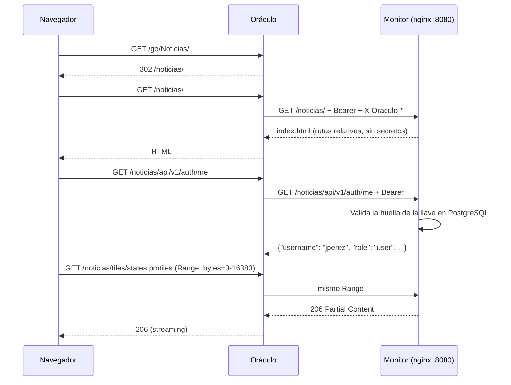

# Monitor de Noticias listo como módulo externo de Oráculo

**Para:** programador del core Oráculo y agentes de IA del equipo
**De:** módulo Monitor de Noticias (VM 108, nginx en `:8080`)
**Fecha:** 2026-11-20
**Estado:** lado módulo **implementado y publicado** en la VM. Sigue el contrato vigente de `gateway_modulos_agentes.md` (commit `5b30686` del core: *mount nativo*, como OSINT en `/osint/…`). Ver ADR-0119 y ADR-0122.

Este documento confirma que el monitor cumple el contrato del gateway y detalla **cómo debe configurarse en Oráculo**.

---

## 1. Resumen ejecutivo

| Pieza | Valor |
|---|---|
| Slug en Oráculo | `Noticias` (el que ya existe). El slug no cambia rutas: solo va en `X-Oraculo-Module` |
| **`href` (upstream)** | **`http://10.244.214.144:8080/noticias/`** (ZeroTier). Es nginx; **no** uses el puerto 8000 |
| Mount nativo | **`/noticias`**: el navegador navega en `https://oraculo/noticias/…` y Oráculo reenvía la misma ruta al upstream |
| Apertura | `GET /go/Noticias/` → `302 /noticias/` |
| Auth hacia el módulo | `Authorization: Bearer orc_live_…` (58 caracteres, una llave por persona) |
| Cabeceras opcionales | `X-Oraculo-User`, `X-Oraculo-User-Id`, `X-Oraculo-Module` (bitácora y aviso en pantalla) |
| Llave en la URL (`?api_key=`) | **No existe**: la llave solo se acepta en el encabezado |
| Quién genera la llave | **El monitor** (pestaña «Accesos»). Oráculo solo la **guarda y reenvía** |
| Dónde viven usuarios y llaves | **PostgreSQL del monitor**: solo la huella HMAC. **La llave completa se ve una sola vez**, al generarla (ADR-0120). **No** en `apis_control` ni en la base de Oráculo |
| Login propio del monitor | **No existe**: la entrada con contraseña está apagada (ADR-0121). Solo se entra con la llave |
| Tiempo de espera | **240 s** en las rutas largas (sección 5.3); el `MODULE_PROXY_TIMEOUT` de 300 s ya alcanza |

El navegador del usuario final **no** ve la IP de la VM ni la llave. La llave viaja solo **Oráculo → monitor** (servidor a servidor).

### Qué Oráculo **no** tiene que construir

- Altas de usuarios del monitor ni sus llaves (ya está en «Accesos»).
- Login del monitor ni roles: los decide el monitor según la llave.
- Reescribir JavaScript: la pantalla usa rutas relativas y funciona igual en `/noticias/`.

Oráculo solo necesita: **el `href` con `/noticias/` + la llave de cada usuario en «Módulos externos»**.

---

## 2. Flujo (producción)

```
Usuario logueado en Oráculo
  → Clic en «Noticias Intelligence» en el hub
  → GET /go/Noticias/
  → Oráculo valida la llave pegada (UserModuleCredential)
  → 302 /noticias/                ← mismo host Oráculo, mount nativo

Navegador (solo host Oráculo)
  → GET|POST /noticias/…

Oráculo (middleware del mount)
  → Reenvía la MISMA ruta a http://10.244.214.144:8080/noticias/…
       Authorization: Bearer orc_live_…
       X-Oraculo-User / X-Oraculo-User-Id / X-Oraculo-Module
  → Responde al navegador (HTML reescrito, el resto en streaming)

nginx del monitor
  → /noticias/… se atiende igual que /… (API, mapas con Range, pantalla)
```



---

## 3. Qué debe configurar el admin en Oráculo

### 3.1 Módulo del hub (Configuraciones → Módulos del hub)

| Campo | Valor |
|---|---|
| `slug` | `Noticias` (se queda igual) |
| **`href`** | **`http://10.244.214.144:8080/noticias/`** — con `/noticias/` al final. Sin token ni `api_key` |
| Externo / activo | Sí / Sí |

> **Por qué importa `/noticias/`:** el gateway toma el *mount* de la ruta del `href`. Con `http://10.244.214.144:8080` (sin ruta) el mount queda vacío, `/go/Noticias/` manda al usuario a `/` y vuelve al tablero de Oráculo. Fue lo que pasó el 20/11/2026.

Salud del servicio (sin llave): `GET http://10.244.214.144:8080/noticias/api/v1/health` → 200, con `"auth_mode": "keys"`.

### 3.2 Llave por usuario (paso a paso)

1. **En el monitor**, un superusuario entra **por Oráculo** (con su propia llave ya pegada) → pestaña **«Accesos»**.
   - **Primera vez** (el superusuario aún no tiene llave en Oráculo): en la VM, `make crear-llave ARGS="--usuario benji"` la muestra una vez; se pega en Oráculo para ese usuario.
2. En la persona (si no existe, **«Nueva persona»**), renglón **«Llave de API»** → **«Generar llave»** (o **«Generar nueva»**).
   - Sale un aviso con la llave completa y **«Copiar llave»**. **Es la única vez que se ve** (ADR-0120).
   - Si se pierde, **«Generar nueva»**: la anterior deja de servir al instante.
3. **En Oráculo** → Usuarios → Editar → **Módulos externos** → «Noticias Intelligence»: pegar la llave (una línea, sin espacios) y **Guardar**.
4. Sin llave pegada → Oráculo responde «No tienes acceso asignado a este módulo».

El usuario final **nunca** ve ni pega la llave.

---

## 4. Contrato HTTP hacia el monitor

### 4.1 Cabeceras

```http
GET /noticias/api/v1/auth/me HTTP/1.1
Host: 10.244.214.144:8080
Authorization: Bearer orc_live_…
X-Oraculo-User: jperez
X-Oraculo-User-Id: 42
X-Oraculo-Module: Noticias
```

| Cabecera | Obligatoria | Uso en el monitor |
|---|---|---|
| `Authorization: Bearer …` | **Sí** | Quién es la persona y su rol. Es lo único que decide la identidad |
| `X-Oraculo-Module` | Recomendada | Marca que se entró por Oráculo (`via_gateway`) |
| `X-Oraculo-User` | No | Log. Si no coincide con el dueño de la llave, queda una advertencia |
| `X-Oraculo-User-Id` | No | Log, para cruzar con la bitácora de Oráculo |
| `X-Forwarded-For` | Recomendada | IP real del analista para la bitácora y el bloqueo por intentos fallidos |

Reglas:

- **No** mandar la llave en la URL ni en el cuerpo.
- Sin llave, o con una mala, vencida o reemplazada → **401** `auth_required`.
- Llave válida sin permiso para esa ruta → **403**. Algo de otra persona → **404**.
- Demasiadas llaves malas desde la misma IP → **429**.
- Los `X-Oraculo-*` y `X-Forwarded-For` solo se creen si llegan desde las IP de `ORACULO_GATEWAY_IPS` (sección 8).

### 4.2 Prueba mínima desde el servidor de Oráculo (curl al upstream)

```bash
U=http://10.244.214.144:8080/noticias
# Sustituye LLAVE por la llave del usuario
curl -sS -o /dev/null -w "%{http_code}\n" -H "Authorization: Bearer LLAVE" "$U/api/v1/auth/me"   # 200
curl -sS -o /dev/null -w "%{http_code}\n" "$U/api/v1/auth/me"                                     # 401
curl -sS -o /dev/null -w "%{http_code}\n" -r 0-16383 "$U/tiles/countries.pmtiles"                 # 206
```

---

## 5. Rutas del módulo

### 5.1 Lo que pide el navegador (todo bajo `/noticias/`)

| Ruta | Qué es | Pide llave |
|---|---|---|
| `/noticias/` | La pantalla (`index.html`, sin caché) | No (es estática) |
| `/noticias/assets/…` | JavaScript, CSS, fuentes, worker del mapa | No |
| `/noticias/tiles/…` | Mapas PMTiles por pedazos (`Range` → **206**). Hasta **1.3 GB** por archivo | No |
| `/noticias/api/v1/…` | La API | **Sí**, salvo las públicas de 5.2 |

`/noticias` sin diagonal redirige (301) a `/noticias/`. La pantalla navega con `#/explorar`, `#/casos`, etc.

### 5.2 Rutas públicas de la API (sin llave)

`GET /noticias/api/v1/health` y `GET /noticias/api/v1/app-config` (`oraculo_url`, `via_gateway`, `password_login`). Las de entrar con contraseña responden **409** (ADR-0121).

### 5.3 Rutas que necesitan hasta 240 s

| Método | Ruta | Por qué tarda |
|---|---|---|
| POST | `/noticias/api/v1/searches/{id}/report` | PDF; la primera vez la IA escribe el resumen |
| GET | `/noticias/api/v1/searches/{id}/report/view` | Reporte en pantalla |
| POST | `/noticias/api/v1/concepts/suggest` | La IA propone frases de búsqueda |
| POST | `/noticias/api/v1/deliveries/test` | Correo de prueba |
| POST | `/noticias/api/v1/deliveries/history/{id}/retry` | Reintento de envío |

Las búsquedas **no** necesitan tiempo largo: responden 202 al instante y la pantalla consulta el avance cada 2 s.

---

## 6. Comportamiento de la pantalla

- **Todas las URLs son relativas** (`./assets/…`, `api/v1/…`, `tiles/…`). Oráculo no tiene que reescribir JavaScript.
- **No hay llave en el navegador**: ni en el HTML, ni en `localStorage`, ni en URLs. El Bearer lo pone Oráculo.
- **No se asume el Host del navegador.** El mapa arma sus URLs a partir de la dirección de la página: `https://oraculo/noticias/tiles/…`.
- **Sin cookies del monitor**: no hay sesión propia; cada petición trae Bearer. Una cookie vieja de cuando había contraseña ya no sirve (ADR-0123).
- **Cerrar sesión en Oráculo cierra el monitor** (ADR-0123): la siguiente petición recibe la pantalla de entrada de Oráculo y el monitor recarga la página; al volver a la pestaña también se revisa. `index.html` va con `no-store` y la API con `no-store`, así que «atrás» no muestra nada guardado.
- **Encabezados de seguridad:** CSP con `'self'` y `X-Frame-Options: DENY`. Funciona como página completa; **en un iframe no abre**.
- **Descargas** (PDF, CSV, GeoJSON) traen `Content-Disposition`: hay que conservarlo.

---

## 7. Roles en el monitor (independientes de Oráculo)

| Rol | Efecto |
|---|---|
| `user` | Explorar, casos, conceptos, historial y envíos **propios** |
| `superuser` | Además: «Estado del sistema» y «Accesos» (personas y llaves) |

El rol vive en la base del monitor. Cada persona ve **solo lo suyo** (seguridad por filas).

---

## 8. Seguridad

- **Una llave robada** da acceso al monitor como esa persona. Se corta con «Generar nueva» en «Accesos» y se pega la nueva en Oráculo.
- **Lista de IP** (`.env` de la VM):
  - `ORACULO_GATEWAY_IPS=10.244.83.211` (IP ZeroTier del servidor de Oráculo): solo a ella se le creen `X-Forwarded-For` y `X-Oraculo-*`.
  - `GATEWAY_ONLY=si`: nadie más entra (403). Se enciende cuando todos entren por Oráculo, con OK del responsable.
- **Candado obligatorio:** la VM no arranca sin llaves (`AUTH_MODE=dev`) si escucha hacia la red. `/health` dice `"auth_mode": "keys"`.
- **Nunca** poner la llave en la URL ni en logs.

---

## 9. Requisitos para el gateway de Oráculo (ya los cumple `proxy.py`)

- [x] Reenviar la misma ruta del mount con su query string.
- [x] Inyectar `Authorization: Bearer <llave>` y `X-Oraculo-*` en cada petición.
- [x] Reenviar `Range` y devolver `206` en streaming (sin juntar ni comprimir).
- [x] Conservar `Content-Type`, `Content-Disposition` y `Cache-Control`.
- [x] Timeout ≥ 240 s (`MODULE_PROXY_TIMEOUT` = 300 s).
- [ ] **Configurar `href` = `http://10.244.214.144:8080/noticias/`** (único pendiente).
- [ ] Opcional: mandar `X-Forwarded-For` con la IP del navegador.

---

## 10. Criterio de aceptación

1. Usuario de Oráculo con su llave del monitor pegada.
2. Clic en el hub → barra `…/noticias/` (mismo host Oráculo).
3. El monitor abre **sin pedir usuario ni contraseña**, con el nombre de la persona arriba a la derecha.
4. El globo carga sus mapas: las teselas responden 206 y **ninguna** petición sale de `/noticias/`.
5. Una búsqueda termina y su reporte en pantalla abre.
6. Usuario con llave mala → «Tu acceso lo da Oráculo». Usuario sin llave → no entra.
7. Cerrar sesión en Oráculo → el monitor ya no responde ni con «atrás»; al volver a su pestaña aparece la entrada de Oráculo.
8. El navegador **no** muestra la IP de la VM ni la llave.

---

## 11. Checklist del módulo (cumplido en el monitor)

- [x] Aceptar `Authorization: Bearer <llave>`; sin llave → 401
- [x] Servir todo bajo el mount nativo `/noticias/` (y también en la raíz)
- [x] URLs relativas en HTML, JS, CSS y mapas; no asumir el Host del navegador
- [x] Leer `X-Oraculo-*` para el log, solo si vienen del gateway
- [x] «Accesos» para crear personas y emitir llaves (se ven una sola vez)
- [x] Sin login propio: solo llave (ADR-0121)
- [x] 240 s en las rutas largas; Range/206 en mapas
- [x] Probado: todas las peticiones de la pantalla quedan dentro de `/noticias/`

---

## 12. Dónde está cada cosa

| Qué | Dónde |
|---|---|
| Servicio | VM 108 · nginx `:8080` · `make up` / `make status` |
| Decisiones | [ADR-0119](adr/0119-gateway-oraculo.md), [ADR-0120](adr/0120-llave-de-api-una-sola-vez.md), [ADR-0121](adr/0121-sin-entrada-con-contrasena.md), [ADR-0122](adr/0122-mount-nativo-noticias.md) |
| Mount `/noticias/`, lista de IP y 240 s | `nginx/monitor-noticias.conf.template`, `nginx/proxy-api.conf`, `scripts/dev/servicios.sh` |
| Rutas relativas de la pantalla | `frontend/src/config/api.ts`, `frontend/vite.config.ts` (`base: './'`) |
| Llaves y candado | `backend/app/api/auth.py`, ADR-0047 |
| Rutas de la API | [api.md](api.md) |
| Contrato de Oráculo | `docs/gateway_modulos_agentes.md` (core) |
