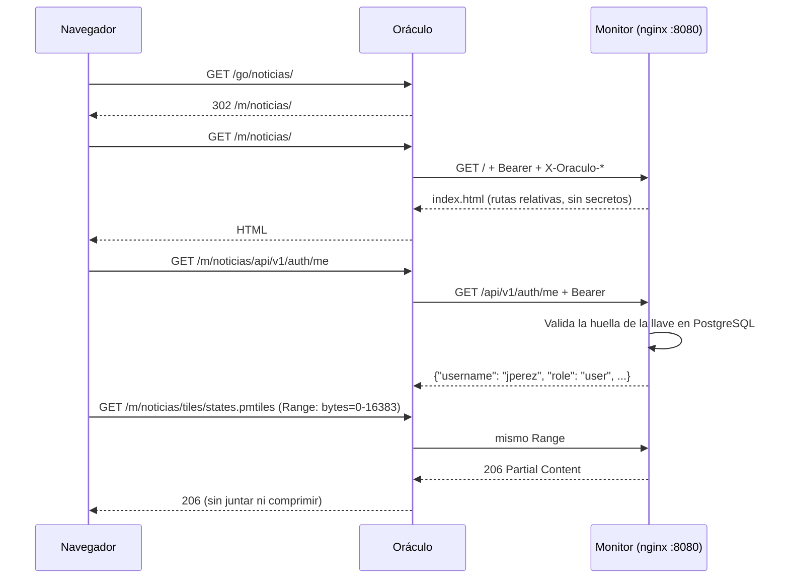

# Monitor de Noticias listo como módulo externo de Oráculo

**Para:** programador del core Oráculo (gateway `/go/<slug>/` → `/m/<slug>/`) y agentes de IA del equipo
**De:** módulo Monitor de Noticias (VM 108, nginx en `:8080`)
**Fecha:** 2026-11-20
**Estado:** lado módulo **implementado y probado** con un Oráculo simulado (ADR-0119). Falta cablear el proxy en Oráculo.

Este documento confirma que el monitor cumple el contrato de `gateway_modulos_agentes.md` y detalla **cómo debe hablar Oráculo** con él.

---

## 1. Resumen ejecutivo

| Pieza | Valor |
|---|---|
| Slug sugerido en Oráculo | `noticias` → público `/m/noticias/` |
| Upstream interno (`href`) | `http://10.244.214.144:8080/` (ZeroTier) o `http://192.168.0.42:8080/` (red de la oficina). Es nginx; **no** uses el puerto 8000 (la API solo escucha en `127.0.0.1`) |
| Prefijo de rutas del módulo | **Ninguno**: el monitor vive en la raíz del upstream. Oráculo quita `/m/noticias` y reenvía el resto tal cual |
| Auth hacia el módulo | `Authorization: Bearer orc_live_…` (58 caracteres, una llave por persona) |
| Cabeceras opcionales | `X-Oraculo-User`, `X-Oraculo-User-Id`, `X-Oraculo-Module` (solo bitácora y aviso en pantalla) |
| Llave en la URL (`?api_key=`) | **No existe**: la llave solo se acepta en el encabezado |
| Quién genera la llave | **El monitor** (pestaña «Accesos» o consola). Oráculo solo la **guarda y reenvía** |
| Dónde viven usuarios y llaves | **PostgreSQL del monitor** (tabla `access_keys`): solo la huella HMAC para validar. **La llave completa se ve una sola vez**, al generarla; el monitor no la puede volver a mostrar. **No** en `apis_control` ni en la base de Oráculo |
| Tiempo de espera | **240 s** en las rutas largas (sección 5.3); el resto cabe en los 30 s por defecto |

El navegador del usuario final **no** debe ver la IP de la VM ni la llave.
La llave viaja solo **Oráculo → monitor** (servidor a servidor).

### Qué Oráculo **no** tiene que construir

- Altas de usuarios del monitor ni sus llaves (ya está en «Accesos»).
- Login propio del monitor para el usuario final: entra por el hub de Oráculo.
- Roles del monitor: los decide el monitor según la llave.

Oráculo solo necesita: **proxy + Bearer en cada petición + campo «llave del módulo» por usuario**.

---

## 2. Flujo esperado (producción)

```
Usuario se loguea en Oráculo
  → Clic en «Noticias Intelligence» en el hub
  → GET /go/noticias/
  → Oráculo valida sesión + UserModuleCredential (llave pegada)
  → 302 /m/noticias/          ← siempre con diagonal final

Navegador (solo host Oráculo)
  → GET|POST /m/noticias/…

Oráculo (proxy)
  → Quita /m/noticias y reenvía a http://<vm>:8080/…
       Authorization: Bearer orc_live_…
       X-Oraculo-User: <username Oráculo>
       X-Oraculo-User-Id: <id Oráculo>
       X-Oraculo-Module: noticias
       X-Forwarded-For: <IP del navegador>
  → Responde al navegador
```



---

## 3. Qué debe configurar el admin en Oráculo

### 3.1 Módulo del hub

| Campo | Valor |
|---|---|
| `slug` | `noticias` |
| `href` (upstream) | `http://10.244.214.144:8080/` o `http://192.168.0.42:8080/`, la que alcance el servidor de Oráculo |
| Timeout del proxy | **240 s** para las rutas de la sección 5.3 (o para todo el módulo, si el proxy no distingue rutas) |

La petición final al monitor debe quedar así: `/m/noticias/api/v1/auth/me` → `http://<vm>:8080/api/v1/auth/me`.

Salud del servicio (sin llave): `GET http://<vm>:8080/api/v1/health` → 200 o 503, con `auth_mode` (`keys` = pide llave).

### 3.2 Llave por usuario (paso a paso)

1. **En el monitor**, un superusuario entra por acceso directo → pestaña **«Accesos»**.
2. En la persona (si no existe, **«Nueva persona»**), renglón **«Llave de API»** → **«Generar llave»** (o **«Generar nueva»** si ya tiene una).
   - Sale un aviso con la llave completa y **«Copiar llave»**. **Es la única vez que se ve**: el monitor solo guarda su huella y no la puede volver a mostrar bajo ningún motivo (ADR-0120).
   - Si se pierde, no se recupera: **«Generar nueva»**, que deja sin servir la anterior.
   - **Para Oráculo usa siempre esta «Llave de API».** `make crear-llave` (consola) crea otra cosa: una *llave de sistema* que no aparece en ese renglón y que «Generar nueva» no mata.
3. **En Oráculo** → Usuarios → Editar → **Módulos externos**: pegar la llave para el módulo `noticias` (una línea, sin espacios).
4. Sin llave pegada → el usuario no debe poder abrir el módulo.

El usuario final **nunca** ve ni pega la llave.

**Renovar:** «Generar nueva» en «Accesos» mata la «Llave de API» anterior al instante. Hay que pegar la nueva en Oráculo; mientras tanto el usuario ve «Tu acceso lo da Oráculo».

---

## 4. Contrato HTTP hacia el monitor

### 4.1 Cabeceras

```http
GET /api/v1/auth/me HTTP/1.1
Host: <host-upstream>
Authorization: Bearer orc_live_…
X-Oraculo-User: jperez
X-Oraculo-User-Id: 42
X-Oraculo-Module: noticias
X-Forwarded-For: <IP del navegador>
```

| Cabecera | Obligatoria | Uso en el monitor |
|---|---|---|
| `Authorization: Bearer …` | **Sí** | Quién es la persona y su rol. Es lo único que decide la identidad |
| `X-Oraculo-Module` | Recomendada | Marca que se entró por Oráculo: la pantalla no ofrece usuario y contraseña, y no muestra «Salir» ni «Mi contraseña» |
| `X-Oraculo-User` | No | Log. Si no coincide con el dueño de la llave, queda una advertencia (una vez por pareja) |
| `X-Oraculo-User-Id` | No | Log, para cruzar con la bitácora de Oráculo |
| `X-Forwarded-For` | Recomendada | IP real del analista para la bitácora y el bloqueo por intentos fallidos. Sin ella, todos parecen la misma persona |

Reglas:

- **No** mandar la llave en la URL ni en el cuerpo.
- Sin llave, o con una llave mala, vencida o reemplazada → **401** `auth_required`. Detrás del gateway, el mensaje dice «Oráculo no mandó una llave válida para el monitor…».
- Llave válida, pero sin permiso para esa ruta → **403**.
- Algo de otra persona → **404** (la seguridad por filas lo oculta).
- Demasiadas llaves malas desde la misma IP → **429**.
- Los `X-Oraculo-*` y el `X-Forwarded-For` solo se creen si llegan desde las IP de `ORACULO_GATEWAY_IPS`. De cualquier otra IP se ignoran.

### 4.2 Prueba mínima desde el servidor de Oráculo (curl al upstream)

```bash
U=http://10.244.214.144:8080     # o http://192.168.0.42:8080
# Sustituye LLAVE por la llave del usuario
curl -sS -o /dev/null -w "%{http_code}\n" \
  -H "Authorization: Bearer LLAVE" -H "X-Oraculo-Module: noticias" \
  "$U/api/v1/auth/me"
# esperado: 200

curl -sS -o /dev/null -w "%{http_code}\n" "$U/api/v1/auth/me"
# esperado: 401

curl -sS -o /dev/null -w "%{http_code}\n" -r 0-16383 "$U/tiles/countries.pmtiles"
# esperado: 206
```

---

## 5. Rutas del módulo

### 5.1 Lo que pide el navegador

| Ruta (tras quitar `/m/noticias`) | Qué es | Pide llave |
|---|---|---|
| `/` | La pantalla (`index.html`, sin caché) | No (es estática; ver 8) |
| `/assets/…` | JavaScript, CSS, fuentes, worker del mapa (con hash en el nombre) | No |
| `/globo.svg` | Ícono | No |
| `/tiles/…` | Mapas PMTiles por pedazos (`Range` → **206**). Hasta **1.3 GB** por archivo (`basemap_mexico.pmtiles`) | No |
| `/api/v1/…` | La API | **Sí**, salvo las públicas de 5.2 |

La pantalla navega con `#/explorar`, `#/casos`, etc. El prefijo no le afecta y no hace falta ningún comodín de rutas.

### 5.2 Rutas públicas de la API (sin llave)

`GET /api/v1/health`, `GET /api/v1/app-config` (dirección de Oráculo y `via_gateway`), los pasos de `POST /api/v1/auth/login…` y `POST /api/v1/auth/logout`. Las de entrar solo sirven en acceso directo.

### 5.3 Rutas que necesitan 240 s

Esperan a la IA o a un proveedor de correo dentro de la petición. El nginx del monitor ya les da 240 s; el proxy de Oráculo debe esperar lo mismo.

| Método | Ruta | Por qué tarda |
|---|---|---|
| POST | `/api/v1/searches/{id}/report` | PDF; la primera vez la IA escribe el resumen ejecutivo |
| GET | `/api/v1/searches/{id}/report/view` | Reporte en pantalla (igual que el anterior) |
| POST | `/api/v1/concepts/suggest` | La IA propone frases de búsqueda |
| POST | `/api/v1/deliveries/test` | Manda un correo de prueba |
| POST | `/api/v1/deliveries/history/{id}/retry` | Reintenta un envío |

Las búsquedas **no** necesitan tiempo largo: responden 202 al instante y la pantalla consulta el avance cada 2 s.

---

## 6. Comportamiento de la pantalla (importante para el proxy)

- **Todas las URLs son relativas** (`./assets/…`, `api/v1/…`, `tiles/…`). Oráculo no tiene que reescribir nada en el HTML ni en el JavaScript.
- **La diagonal final es obligatoria.** Sin ella, el navegador resuelve las rutas relativas contra `/m/` y todo falla. Oráculo debe redirigir `/m/noticias` → `/m/noticias/` (301).
- **No hay llave en el navegador:** ni en el HTML, ni en `localStorage`, ni en URLs. Las peticiones salen sin `Authorization` y el Bearer lo pone Oráculo.
- **No se asume el Host del navegador.** El mapa arma sus URLs absolutas a partir de la dirección de la página, así que pide `https://oraculo/m/noticias/tiles/…`.
- **Cookie:** solo existe en acceso directo (`monitor_sesion`, `Path=/api`, `HttpOnly`, `SameSite=Strict`). Detrás del gateway no hace falta, porque cada petición trae Bearer.
- **Encabezados de seguridad:** `Content-Security-Policy` con `'self'` y `X-Frame-Options: DENY`. Todo es del mismo origen (`https://oraculo/m/noticias/…`), así que funciona como página completa. **En un iframe no abre** (ver 10).
- **Descargas** (PDF, CSV, GeoJSON) traen `Content-Disposition`: hay que conservarlo.

---

## 7. Roles en el monitor (independientes de Oráculo)

| Rol | Efecto |
|---|---|
| `user` | Explorar, casos, conceptos, historial y envíos **propios** |
| `superuser` | Además: «Estado del sistema» y «Accesos» (personas y llaves) |

El rol vive en la base del monitor. Oráculo no necesita conocerlo: solo manda la llave correcta. Cada persona ve **solo lo suyo**, porque la base aplica seguridad por filas.

---

## 8. Seguridad (acuerdo operativo)

- **Una llave robada** da acceso al monitor como esa persona (si es superusuario, incluye «Accesos»). No abre la sesión de Oráculo.
- **Si una llave se filtra,** se pulsa «Generar nueva» en «Accesos» y se pega la nueva en Oráculo. La «Llave de API» anterior muere al instante. (Si por error se pegó una llave de sistema de `make crear-llave`, hay que revocarla aparte en «Accesos».)
- **Lista de IP** (`.env` de la VM):
  - `ORACULO_GATEWAY_IPS=<IP del proxy de Oráculo>`: solo a esas IP se les cree `X-Forwarded-For` y `X-Oraculo-*`.
  - `GATEWAY_ONLY=si`: nadie más entra (403), ni a la API ni a la pantalla ni a los mapas. **Hoy está en `no`**, para no cortar el acceso directo, y se enciende cuando Oráculo ya entre.
- **Candado obligatorio:** la VM no arranca en modo desarrollo (`AUTH_MODE=dev`) si escucha hacia la red. `GET /api/v1/health` dice `"auth_mode": "keys"`.
- **Nunca** poner la llave en la URL del navegador ni en logs. El monitor nunca la escribe en sus logs.

---

## 9. Requisitos para el proxy de Oráculo (checklist)

- [ ] Quitar `/m/noticias` y reenviar el resto, **con el query string** (`?laboratorio`, etc.).
- [ ] Redirigir `/m/noticias` → `/m/noticias/`.
- [ ] Inyectar `Authorization: Bearer <llave>` y `X-Oraculo-*` en **cada** petición.
- [ ] Mandar `X-Forwarded-For` con la IP del navegador.
- [ ] **Range sin tocar:** reenviar el `Range` de la petición y devolver tal cual `206`, `Content-Range`, `Accept-Ranges`, `Content-Length` y `ETag`.
  - Sin juntar la respuesta en memoria (en Django: `requests` con `stream=True` + `StreamingHttpResponse`).
  - Sin comprimir los `.pmtiles`.
  - Un archivo pesa hasta 1.3 GB y nunca se pide completo.
- [ ] Conservar `Content-Type`, `Content-Disposition` y `Cache-Control`. Las respuestas de la API dicen `no-store`: **no** guardarlas en caché.
- [ ] 240 s en las rutas de la sección 5.3.
- [ ] Abrir el módulo como **página completa**, no en iframe.
- [ ] Usuario sin llave pegada → no entra.

---

## 10. Preguntas abiertas para Oráculo

1. ¿El módulo se abre como página completa o dentro de un iframe? Con iframe hay que cambiar encabezados del monitor (ADR nuevo).
2. ¿El proxy quita el prefijo `/m/noticias` antes de reenviar?
3. ¿Desde qué IP sale el proxy hacia la VM? Va en `ORACULO_GATEWAY_IPS`.
4. ¿El servidor de Oráculo alcanza `10.244.214.144` (ZeroTier) o `192.168.0.42`?
5. ¿El proxy ya transmite por pedazos (streaming) o junta la respuesta completa?

---

## 11. Criterio de aceptación (lado Oráculo)

Cuando el gateway esté listo, esto debe funcionar:

1. Usuario de Oráculo con su llave del monitor pegada.
2. Clic en el hub → barra `…/m/noticias/` (mismo host Oráculo).
3. El monitor abre **sin pedir usuario ni contraseña**, con el nombre de la persona arriba a la derecha.
4. El globo carga sus mapas: en la pestaña Red del navegador, las teselas responden 206 y **ninguna** petición sale de `/m/noticias/`.
5. Una búsqueda completa termina y su reporte en pantalla abre (tiempo largo).
6. Usuario con una llave mala → ve «Tu acceso lo da Oráculo».
7. Usuario **sin** llave en Oráculo → no entra.
8. El navegador **no** muestra la IP de la VM ni la llave.

Prueba de humo a través del gateway, desde cualquier máquina con sesión de Oráculo:

```bash
curl -sS -b cookies-oraculo.txt -o /dev/null -w "%{http_code}\n" https://oraculo/m/noticias/            # 200
curl -sS -b cookies-oraculo.txt https://oraculo/m/noticias/api/v1/app-config                            # "via_gateway": true
curl -sS -b cookies-oraculo.txt -o /dev/null -w "%{http_code}\n" -r 0-16383 https://oraculo/m/noticias/tiles/countries.pmtiles  # 206
```

---

## 12. Checklist del módulo (cumplido en el monitor)

- [x] Aceptar `Authorization: Bearer <llave>`
- [x] Sin llave → 401 (con mensaje propio detrás del gateway)
- [x] Leer `X-Oraculo-*` para el log, solo si vienen del gateway
- [x] URLs relativas en HTML, JS, CSS y mapas
- [x] No asumir que el Host del navegador es el del módulo
- [x] Panel para crear personas y emitir llaves para pegar en Oráculo («Accesos»)
- [x] Llaves en la base del monitor: solo la huella HMAC; la llave se ve una sola vez al generarla y renovar mata la anterior
- [x] IP real del analista desde el gateway; lista de IP lista para encenderse
- [x] 240 s en las rutas largas
- [x] Probado con un Oráculo simulado (nginx que quita el prefijo e inyecta la llave): pantalla, API, 206 en mapas, IP real en la bitácora, aviso con llave mala

---

## 13. Dónde está cada cosa

| Qué | Dónde |
|---|---|
| Servicio | VM 108 · nginx `:8080` · `make up` / `make status` |
| Decisión | [ADR-0119](adr/0119-gateway-oraculo.md) |
| Rutas relativas de la pantalla | `frontend/src/config/api.ts` (`apiUrl`, `pageBase`), `frontend/vite.config.ts` (`base: './'`) |
| Candado y encabezados de Oráculo | `backend/app/api/auth.py` |
| `via_gateway` | `backend/app/api/v1/app_config.py` |
| Lista de IP, IP real y 240 s | `nginx/monitor-noticias.conf.template`, `nginx/proxy-api.conf`, `scripts/dev/servicios.sh` |
| Llaves por persona | ADR-0047, [guia-integracion-api.md](guia-integracion-api.md) |
| Rutas de la API | [api.md](api.md) y `/api/v1/docs` (solo en acceso directo) |
| Contrato original de Oráculo | `gateway_modulos_agentes.md` (core) |
